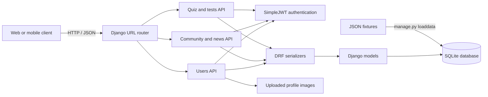
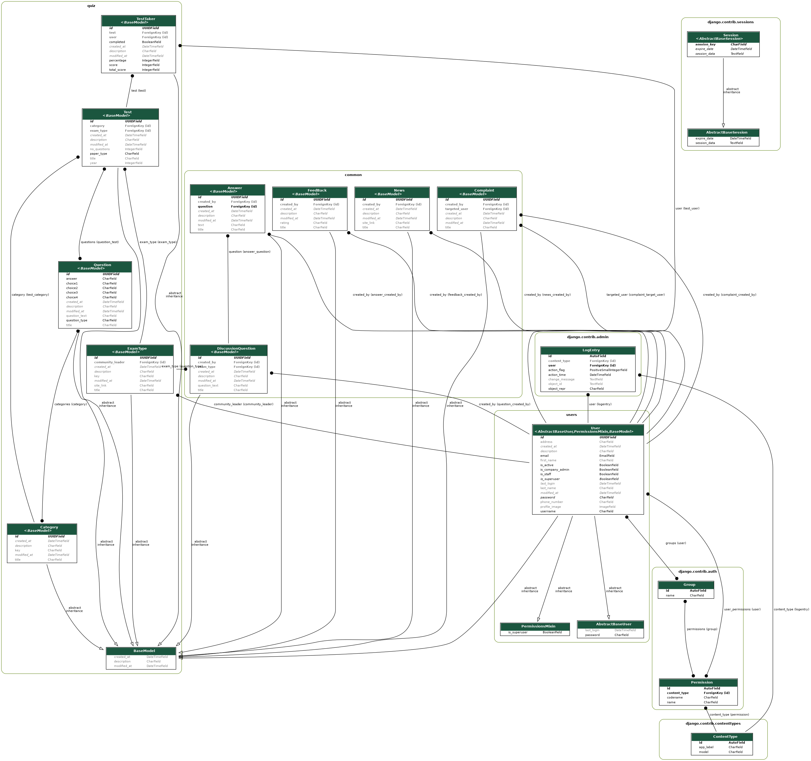

# EducationCircle

EducationCircle is a Django REST API for exam preparation. It provides user registration and authentication, exam categories and types, mock and previous-year tests, test results, news, feedback, complaints, and a question-and-answer community.

## Project layout

- `EduCircleBackend/` contains the Django project and the `users`, `common`, and `quiz` apps.
- The default database is SQLite (`EduCircleBackend/db.sqlite3`). SQLite is included with Python.
- JSON fixtures for sample categories, exam types, questions, and news are under the apps' `fixtures/` directories.

## Architecture



The database entity diagram is available here:



## Requirements

- Python 3.14 (Django 5.2 LTS and later 5.2 patch releases support Python 3.14)
- Dependencies listed in [`EduCircleBackend/requirements.txt`](EduCircleBackend/requirements.txt)

## Local setup

From the repository root, create and activate a virtual environment, install dependencies, and run database migrations:

```sh
python3.14 -m venv .venv
source .venv/bin/activate
python -m pip install --upgrade pip
python -m pip install -r EduCircleBackend/requirements.txt
cd EduCircleBackend
python manage.py migrate
python manage.py runserver
```

The API is then available at `http://127.0.0.1:8000/`. The root URL has no landing page; API routes are grouped under `/api/users/`, `/api/common/`, and `/api/quiz/`. The project does not currently define automated tests beyond Django's empty app test modules.

### Load sample data

After migrations, run from `EduCircleBackend/`:

```sh
python manage.py loaddata common/fixtures/news.json
python manage.py loaddata quiz/fixtures/exam_types.json
python manage.py loaddata quiz/fixtures/category.json
python manage.py loaddata quiz/fixtures/questions.json
```

Or run `./populate_data.sh` from that directory.

## Authentication

Register and sign in through the endpoints in `users/urls.py`. The sign-in endpoint (`POST /api/users/token`) returns a JWT access token in the `token` field. Send it on authenticated requests as `Authorization: JWT <token>`. Access tokens last nine hours and refresh tokens last seven days. The move from the legacy JWT package to SimpleJWT changes token claims, so clients must sign in again to obtain new tokens.

## API endpoints

All endpoints below are relative to `http://127.0.0.1:8000`. Unless marked **Public**, send the access token as `Authorization: JWT <token>`. The server returns 401 for protected endpoints when the token is missing or invalid.

### Users (`/api/users/`)

| Method | Path | Access | Description |
| --- | --- | --- | --- |
| POST | `/api/users/token` | Public | Sign in with `email` and `password`; returns an access token. |
| POST | `/api/users/register` | Public | Register a user. Accepts multipart form data for optional profile image uploads. |
| GET | `/api/users/manage?user_id=<uuid>` | Authenticated | Retrieve a user by ID. |
| PUT | `/api/users/manage?user_id=<uuid>` | Authenticated | Update a user's profile. |
| GET | `/api/users/user-list` | Authenticated | List up to 30 recently created users. |

### Common (`/api/common/`)

| Method | Path | Access | Description |
| --- | --- | --- | --- |
| POST | `/api/common/feedback` | Authenticated | Submit feedback (`title`, `description`, `rating`). |
| POST | `/api/common/complaint` | Authenticated | Submit a complaint (`title`, `description`, `targeted_user_id`). |
| GET | `/api/common/news-list` | Authenticated | List up to 20 latest news items. |
| POST | `/api/common/post-question` | Authenticated | Post a discussion question. |
| POST | `/api/common/post-answer` | Authenticated | Answer a discussion question. |
| GET | `/api/common/question-list?exam_type=<key>` | Authenticated | List questions for an exam type; defaults to `ssc`. |
| GET | `/api/common/answer-list?question_id=<uuid>` | Authenticated | List answers for a question. |

### Quiz (`/api/quiz/`)

| Method | Path | Access | Description |
| --- | --- | --- | --- |
| GET | `/api/quiz/category-list` | Authenticated | List quiz categories. |
| GET | `/api/quiz/exam-type-list` | Authenticated | List exam types. |
| GET | `/api/quiz/year-list?exam_type=<key>` | Authenticated | List previous-year tests for an exam type; defaults to `ssc`. |
| GET | `/api/quiz/mock-test-list?exam_type=<key>` | Authenticated | List mock tests; defaults to `ssc`. |
| GET | `/api/quiz/category-test-list?category=<key>` | Authenticated | List category quizzes; defaults to `current_affairs`. |
| GET | `/api/quiz/get-test?test_id=<uuid>` | Authenticated | Retrieve a test and its questions. |
| POST | `/api/quiz/save-test` | Authenticated | Save the signed-in user's test result. |
| GET | `/api/quiz/get-results` | Authenticated | List the signed-in user's test results. |

### Django admin

| Method | Path | Access | Description |
| --- | --- | --- | --- |
| GET/POST | `/admin/` | Django staff account | Django administration site. |

No OpenAPI schema route or frontend application is configured currently.

## Production notes

The repository includes Gunicorn as a WSGI server dependency. Before deploying, configure a private `SECRET_KEY`, turn off `DEBUG`, restrict `ALLOWED_HOSTS`, and configure static/media storage and a production database as appropriate for the hosting provider. The checked-in settings currently use development-oriented defaults and should not be exposed directly to the public internet.
